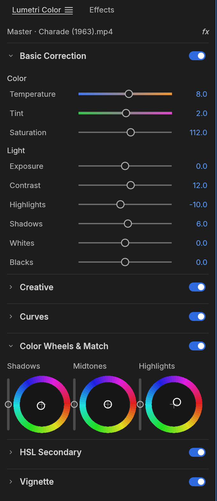

<h1 align="center">AutoCut</h1>

<p align="center">
  <b>An agent-driven, local-first video editor.</b><br>
  Tell an AI agent what film you want; local models on your own computer do the media work.<br>
  Built on <a href="https://github.com/storytold/filmcraft">FilmCraft</a>, the open-source, pure-Rust professional editor.
</p>

<p align="center">
  <a href="https://www.youtube.com/watch?v=P3VMqTmsAlM"></a><br>
  <sub>▶ <a href="https://www.youtube.com/watch?v=P3VMqTmsAlM"><b>Watch: an AI agent edited this video on my MacBook</b></a> (Malayalam, turn on English subtitles)</sub>
</p>

<p align="center">
  📝 <a href="https://www.h4hacks.com/2026/11/blog-post_21.html"><b>Blog post: the story, the measured numbers, and how to run it</b></a> ·
  🗂️ <a href="https://github.com/moheshmohan/FrameAtlas"><b>FrameAtlas</b></a>, the footage catalogue that goes with it
</p>

<p align="center">
  <a href="#run-it">Run it</a> ·
  <a href="#use-it-with-ai">Use it with AI</a> ·
  <a href="#what-autocut-adds">What AutoCut adds</a> ·
  <a href="#made-with-autocut">Made with AutoCut</a> ·
  <a href="#frameatlas">FrameAtlas</a> ·
  <a href="#the-filmcraft-editor-underneath">The editor</a> ·
  <a href="#license-and-credits">License</a>
</p>

> [!NOTE]
> AutoCut is an independent fork of [FilmCraft](https://github.com/storytold/filmcraft) by the
> ArtCraft team. It is not an ArtCraft product, and FilmCraft's name and marks belong to its authors.
> No AI model is bundled: you install the ones you want, and each keeps its own licence.

<br>

## Why

Cloud agents are great at planning an edit, but every frame they look at costs tokens. Most of video
editing is not thinking: it is watching footage, transcribing, generating a voice, rendering and
checking. AutoCut lets the agent plan and decide, while the Mac does that work with local models.

In a measured run, a fresh Claude Code session made a 70-second Malayalam film from a one-line brief
in 57 minutes; local tools were working for 39 of them, and the cloud model wrote 86,165 output
tokens, about half of what the same brief took a week earlier. The
[blog post](https://www.h4hacks.com/2026/11/blog-post_21.html) has the full numbers and what they
do and do not show.

<br>

## Run it

### What you need

- **A Mac with Apple silicon** for the local AI pipeline (tested on an M3 Max with 36 GB). The editor
  itself also builds on Windows and Linux.
- **[Rust](https://rustup.rs) 1.95 or newer** and Git.
- Optional, for the AI features: **[Ollama](https://ollama.com)**; **Python 3.9+** for FrameAtlas;
  **[Render Anything (RAEA)](https://github.com/shinyobjectz/raea)** for animations;
  **Insta360 Studio** for 360° recordings kept in the Insta360 cloud.

### Build and open the app

```sh
git clone https://github.com/moheshmohan/AutoCut
cd AutoCut
cargo run --release -p filmcraft                      # the desktop app, with a demo project
cargo run --release -p filmcraft -- --control 9877    # the same, with the control channel open for agents
cargo build --release -p filmcraft-cli                # the command-line tool: target/release/filmcraft-cli
```

The first release build takes a while. You then have a full editor: import media, cut on the
timeline, grade, mix, add titles and export, with the panels and shortcuts of a professional NLE.
AutoCut's additions live in the same app: **Window ▸ Generate** for local generation, the
**Showcase** panel, Export's **Upload to Google Photos**, and the publish pre-flight.

To make a macOS app bundle named AutoCut instead of running from Cargo:

```sh
AUTOCUT_APP_NAME=AutoCut AUTOCUT_BUNDLE_ID=com.example.autocut \
AUTOCUT_APP_ICON=packaging/autocut/AutoCut.icns packaging/macos/package.sh --arch aarch64
```

Japanese text in the interface and in titles uses the optional
[craft-fonts](https://github.com/storytold/craft-fonts): clone it next to AutoCut and build with
`CRAFT_FONTS_DIR="$PWD/../craft-fonts"`. Without it the editor uses its own and the system's fonts.

### Local models (optional)

```sh
ollama pull qwen2.5vl:7b     # looks at clips, drives the Google Photos picker, privacy checks, QA
ollama pull qwen3:8b         # writes scripts, including Malayalam
ollama pull phi4-mini        # classifies plain-language edit requests
```

The editor's own models (speech recognition, voices, music, upscaling, voice isolation, depth) are
downloaded into its data folder only when you ask for them. See what is installed with, for example,
`filmcraft-cli exec transcript.models`, `filmcraft-cli exec music.neuralModels` and
`filmcraft-cli exec audio.voiceModelStatus`.

### Connect your media (optional)

| Source | How |
|---|---|
| Google Photos | Your own Google Cloud OAuth client ([crates/gphotos](crates/gphotos/README.md)), then `filmcraft-cli photos auth` once and `filmcraft-cli photos pick` |
| Insta360 | `filmcraft-cli insta360 list` / `insta360 import`, from Insta360 Studio's download folder ([docs/360-video.md](docs/360-video.md)) |
| Your voice | Record a reference and make a voice from it ([docs/voice-recording.md](docs/voice-recording.md)). Clone a voice only with its owner's consent |
| Generation tools | List the image, clip and sound models you installed in one file ([docs/generation.md](docs/generation.md)) |
| Animations | Render Anything scenes imported as clips ([docs/raea-workflow.md](docs/raea-workflow.md)) |
| Your footage library | [FrameAtlas](#frameatlas) |

<br>

## Use it with AI

Every menu item, button and slider in the editor is a **command** with typed parameters. The app,
the CLI, a JSON control channel and an **MCP server** all run the same commands, so an agent edits
exactly the way a person does, and whatever it makes stays an ordinary, editable project.

### With Claude Code

1. Build the CLI (`cargo build --release -p filmcraft-cli`). To watch the agent work, open the app
   with its control channel: `cargo run --release -p filmcraft -- --control 9877`.
2. Open the AutoCut folder in Claude Code. Its [`.mcp.json`](.mcp.json) registers two MCP servers:
   `filmcraft`, a bridge to the running app, and `filmcraft-headless`, a headless engine with a demo
   project.
3. The agent starts from [docs/autocut-agent-guide.md](docs/autocut-agent-guide.md): which pipeline
   fits which request, how to build an edit by hand, checks, export and delivery.
4. Ask for a film. This is close to the brief of the measured run:

> Make a finished short film with AutoCut. "Machines in Motion", 60 to 80 seconds, 1920x1080. Use my
> own footage, found with FrameAtlas: robots, a 3D printer at work, a drive, and one 360° shot
> reframed with a camera move. Malayalam narration in my cloned voice, told with feeling. Music and
> a few subtle effects made locally, one Render Anything title, sidecar captions, and no readable
> faces of bystanders. Local tools do all the media work. Keep a ledger of every step.

Smaller requests work the same way: *"cut the silences from this interview and add captions"*,
*"make a 30-second vertical reel of these trip clips on the beat"*, *"blur the faces and number
plates, then check the export for YouTube"*.

Good habits: ask for a 1080p review export first and the 4K final after you approve it; have the
agent listen back to its narration and run the privacy check; keep its project file.

### With any MCP client

Claude Desktop or any other MCP client can drive AutoCut (and FrameAtlas):

```json
{
  "mcpServers": {
    "autocut":    { "command": "/absolute/path/to/AutoCut/target/release/filmcraft-cli",
                    "args": ["mcp", "--bridge", "127.0.0.1:9877"] },
    "frameatlas": { "command": "/absolute/path/to/FrameAtlas/run.sh", "args": ["mcp"] }
  }
}
```

Use `["--project", "/path/to/film.fcproj", "mcp"]` instead of the `--bridge` arguments for a headless engine on
your own project. The tools include `command_list` / `command_run` for every engine command,
`autocut_plan` / `autocut_edit` for plain-language edits, `ui_screenshot` / `ui_click` for the
running app, and pipelines such as `quick_short`, `showcase_build`, `auto_redact` and `youtube_upload`.
The protocol is in [docs/control-protocol.md](docs/control-protocol.md).

### From the command line, with local models only

No cloud agent at all: a local model classifies the request and deterministic planners turn it into
commands. Every edit lands in the undo history.

```sh
CLI=target/release/filmcraft-cli
$CLI --project edit.fcproj --save autocut "remove the silences and add captions"
$CLI quick ~/Movies/expo --topic "Robots at the expo" --seconds 30 --export expo.mp4 --save-as expo.fcproj
$CLI direct ~/Movies/trip --brief "a 30 s reel of our trip" --aspect 9:16 --seconds 30 --export trip.mp4 --save-as trip.fcproj
$CLI showcase --album "Robot showcase" --prompt "every robot I've filmed since 2020" --export robots.mp4 --project robots.fcproj --save
$CLI --project expo.fcproj redact --kinds faces,plates --dry-run
$CLI publish check youtube expo.mp4
```

Each pipeline writes a report, a frame sheet and a QA file next to its export. Read them before you
share anything.

<br>

## What AutoCut adds

AutoCut adds local-first automated editing on top of the FilmCraft engine
([`crates/autocut`](crates/autocut/README.md)). Ask in plain language and it plans and runs
ordinary engine commands — every edit lands in History and undoes like a person's:

```sh
filmcraft-cli --demo autocut "cut the first 3 seconds"        # plan + run
filmcraft-cli --project edit.fcproj autocut "remove the silences and add captions"
filmcraft-cli autocut "make a 60-second highlight reel about the launch" --dry-run
```

- **Local models do the routine work**: a small LLM (Ollama, e.g. `phi4-mini`) classifies the
  prompt, deterministic planners turn routine intents into validated commands — auto captions
  (with TikTok/bold/clean styles), voice enhancement (Essential Sound presets + loudness
  matching), auto voice-over (built-in speech synthesis, Kokoro neural voices optional),
  easy exports (YouTube/TikTok/Reels/ProRes/GIF/audio destinations), smooth slow motion with
  optical-flow interpolation, silence/filler removal, highlight reels. The built-in Whisper
  transcribes, and a small vision model (moondream) captions sampled frames.
- **The supervisor is the MCP client**: prompts the local planner can't handle come back with
  `needsSupervisor` plus the document digest (and captioned frames on request) — Claude, driving
  the editor over MCP, then plans the edit itself with `command_list` / `command_run`, the same
  tools its UI uses. No API keys, no cloud dependency in the editor.
- **Everywhere the engine is**: `filmcraft-cli autocut`, and the `autocut_plan` / `autocut_edit`
  MCP tools — so Claude Desktop can drive editing in the live Mac app (`filmcraft --control
  9877` + `filmcraft-cli mcp --bridge 127.0.0.1:9877`).
- **Cloud media**: pick photos and videos in the Google Photos picker and import them, from
  the CLI (`filmcraft-cli photos pick`) and over MCP (`googlephotos_pick`) — see
  [crates/gphotos](crates/gphotos/README.md) for the one-time Google Cloud setup and what
  Google's Picker API can and cannot do. With `--auto "query"` (CLI) or `query` (MCP), a
  local vision agent drives the picker itself — it types the query into the picker's own
  search, selects matching videos and presses Done ([crates/screenagent](crates/screenagent/README.md);
  Qwen2.5-VL via Ollama). With `--album "<title>"` (CLI) or `album` (MCP) it picks a whole
  album instead: curate the seed of a video in Google Photos, and the agent opens that album
  in the picker and selects all of it. `filmcraft-cli showcase --album "<title>" --prompt "a
  video of every robot since 2020"` turns that album into the finished video in one command —
  picked, imported once, only its clips analysed, built, exported and uploaded
  ([crates/autocut](crates/autocut/README.md#album-as-the-seed)).
- **Back to Google Photos**: upload a finished export to your library — Export mode's
  **Upload to Google Photos**, `filmcraft-cli photos upload <file>`, `showcase … --export
  out.mp4 --upload`, the `photos.upload` command and the `googlephotos_upload` MCP tool
  (resumable 8 MiB chunks, progress, cancel). It needs the Photos Library API enabled and a
  one-time `filmcraft-cli photos auth --upload`; picker-only sign-ins are never asked for it.
  `--album "<title>"` (`showcase … --upload-album`, MCP `album`) also puts it into an album
  FilmCraft makes (reused by title), where you add the next iteration's material by hand:
  `photos album create|add`,
  `photos albums` and the `photos.createAlbum` / `photos.albums` / `photos.addToAlbum`
  commands, after `photos auth --albums`.
- **Generate with your own local models**: pictures, short clips, music and sound effects
  made by generation tools installed on your computer, imported and placed on the timeline
  as one undo step. Fill an empty stretch of a track with a clip that carries on from the
  frame before it, runs from the frame before to the frame after, or continues the movement
  (`generate.fillGap`); carry a shot on past its end (`generate.extend`); make a clip again in
  another look, or with another character in a person's place (`generate.restyle`); change what a frame
  shows from an instruction (`generate.augment`: "add a red sailboat"); make up to four
  variations and swap one in; build a motion-graphics scene's pictures, cut-outs, clips and
  sounds from one list (`generate.assets`). Window ▸ Generate in the app, `generate.*`
  commands from the CLI and over MCP. The app bundles and downloads no model: you list your
  tools in one file ([docs/generation.md](docs/generation.md)).

<br>

## Made with AutoCut

Films from the [H4hacks](https://www.youtube.com/@h4hacks) channel, edited with AutoCut and its
local pipeline (narration in Malayalam, with English subtitles):

<table>
  <tr>
    <td width="50%" align="center"><a href="https://www.youtube.com/watch?v=P3VMqTmsAlM"></a><br><sub><b>An AI agent edited this video on my MacBook</b><br>AutoCut and FrameAtlas, a measured agent run</sub></td>
    <td width="50%" align="center"><a href="https://www.youtube.com/watch?v=7FYPOxDYWBc"></a><br><sub><b>Every Robot I've Met, 2013–2025</b><br>a narrated showcase built from one Google Photos album</sub></td>
  </tr>
  <tr>
    <td width="50%" align="center"><a href="https://www.youtube.com/watch?v=4yar4MbF71g"></a><br><sub><b>My 3D Printing Saga, Part 2: From Kit to Colour</b><br>years of clips and photos, cut into a story</sub></td>
    <td width="50%" align="center"><a href="https://www.youtube.com/watch?v=xLedXwsO1O4"></a><br><sub><b>A knob that became a desk robot</b><br>a maker build video: CAD, 3D printing and firmware</sub></td>
  </tr>
</table>

<br>

## FrameAtlas

[FrameAtlas](https://github.com/moheshmohan/FrameAtlas) catalogues the footage you already have in
Google Photos, on Insta360 cameras and in local folders: what is in each scene, and when. An agent
asks for "the yellow robot dog walking" and gets back a file and a time range, so it does not have
to watch everything itself.

```sh
git clone https://github.com/moheshmohan/FrameAtlas      # next to the AutoCut folder
cd FrameAtlas && ./run.sh serve                           # then open http://127.0.0.1:7318
```

It has no pip or npm dependencies and keeps its catalogue on your computer. Once your media is
catalogued, AutoCut searches it and pulls the originals into an editable project:

```sh
filmcraft-cli catalog search '{"query": "yellow robot dog walking", "limit": 8}'
```

<br>

## The FilmCraft editor underneath

FilmCraft is a professional non-linear editor: familiar panels, workspaces, tools and shortcuts, so your hands already know where everything is. Underneath, it is new from the bitstream up. The H.264, HEVC, ProRes and AAC codecs are our own, written in Rust from the public specifications. A GPU compositor works in linear light. Frame math runs on exact integer time, so edits never drift. And every action in the app is a command that an AI agent can drive as precisely as you can.

<p align="center">
  
</p>

<p align="center"><sub><i>Apollo 11 - Tranquility</i>: a three-minute documentary edit of NASA's 1969 launch, landing and moonwalk film, with subtitles from the mission transcript. Every frame in these screenshots comes from public-domain footage, decoded, composited and graded by FilmCraft's own code.</sub></p>

<p align="center">
  <a href="#edit">Edit</a> ·
  <a href="#color">Color</a> ·
  <a href="#effects-and-motion">Effects</a> ·
  <a href="#audio">Audio</a> ·
  <a href="#titles-and-captions">Titles</a> ·
  <a href="#formats-and-codecs">Formats</a> ·
  <a href="#export">Export</a> ·
  <a href="#interchange">Interchange</a> ·
  <a href="#built-for-agents">Agents</a>
</p>

<br>

## Edit

<p align="center">
  
</p>

<p align="center"><sub>The Assembly workspace, cutting a trailer for <i>Night of the Living Dead</i> (1968) with an insert from <i>Carnival of Souls</i> (1962).</sub></p>

**A timeline you already know.** Source and Program monitors, bins with thumbnails, a multi-track timeline with patch and target buttons, sync locks and linked selection. The Editing, Assembly, Color, Effects and Audio workspaces are all there, and every panel docks wherever you want it.

- **Three-point editing.** Mark In and Out in the Source monitor, then insert (`,`) or overwrite (`.`) onto the patched tracks. Lift (`;`) and extract (`'`) take ranges back out.
- **Every trim.** Ripple, roll, slip, slide, rate stretch and razor tools. Trim mode selects edit points as ripple, roll or trim, nudges them a frame at a time (`⌥←` `⌥→`, ×5 with `⇧`), toggles the trim type with `⌃T` and extends them to the playhead with `E`. `Q` and `W` ripple-trim to the playhead. The **Trim Monitor** shows both sides of the edit, the **Slip Monitor** shows the frames around a slip as you drag it (previous clip's Out, the new In and Out, next clip's In), and **dynamic trimming** trims live while it plays: `L` forward, `J` back, `K` to stop and commit as one undo step.
- **Exact time.** Every edit is computed on integer ticks: 254,016,000,000 per second, which divides evenly by every common frame rate and sample rate. 23.976, 29.97 drop-frame and 59.94 are exact, not approximate.
- **The details pros rely on.** Markers with colours, names and durations; export sequence review notes with **Markers ▸ Export Markers as CSV…**; add edit (`⌘K`) on one or all tracks; nesting; copy, paste and paste insert; ripple delete and close gap; snapping; unlimited undo with a History panel.
- **Your keys.** A Keyboard Shortcuts editor (`⌥⌘K`) with a drawn keyboard, panel-specific shortcuts, conflict warnings and presets for FilmCraft and standard NLE key layouts.
- **Never lose work.** Saves are atomic, auto-save keeps a rolling set of versions, and a crash-recovery journal written about a second after each edit brings back unsaved changes after a crash or power cut.

<p align="center">
  
</p>

<p align="center"><sub>Up close: dissolves, an insert on V2, the score on A2, coloured markers, and the loudness meters on the right.</sub></p>

<br>

## Color

<p align="center">
  
</p>

<p align="center"><sub>The Color workspace on <i>Charade</i> (1963), with live scopes beside the Program monitor.</sub></p>

**A complete color grading panel**, in the order a colourist works:

- **Basic Correction:** temperature and tint, exposure, contrast, highlights, shadows, whites, blacks, saturation.
- **Creative:** eight built-in looks with an intensity control, plus faded film, sharpen and vibrance. The looks are colour transforms written in code, not LUT files.
- **Curves:** an RGB curve editor with monotone-cubic interpolation (no overshoot), and hue vs saturation, hue vs hue, hue vs luma, luma vs saturation and saturation vs saturation.
- **Color Wheels:** shadow, midtone and highlight wheels, each with its own lightness control.
- **HSL Secondary:** key a colour by hue, saturation and luma, view the key as a matte, and correct only what you selected.
- **Vignette:** amount, midpoint, roundness and feather.

<table>
  <tr>
    <td width="34%" valign="top" align="center">
      <br>
      <sub><b>The color grading panel.</b> Basic Correction, Color Wheels and every other section, each with its own on/off switch.</sub>
    </td>
    <td width="66%" valign="top" align="center">
      <br>
      <sub><b>Scopes that tell the truth.</b> The waveform and vectorscope are computed from the graded frame. All grading happens in linear light, in 32-bit float.</sub>
    </td>
  </tr>
</table>

<br>

## Effects and motion

<p align="center">
  
</p>

<p align="center"><sub>NASA's <i>Earth Views from the ISS</i> with a look applied, and the Effects browser open on the dissolves.</sub></p>

- **A comprehensive Video Effects bin (over 90 effects across 16 categories), legacy effects, plus around 30 transitions.** Blurs (Bokeh, Focus, Compound), keys (Ultra Key, Track Matte), distortions (Corner Pin, Turbulent Displace, Warp Stabilizer), Lights & Glows, Immersive Video (VR) effects on equirectangular footage, Posterize Time, Echo and more. Cross dissolve, dip to black or white, film dissolve, wipes, irises, pushes, slides, zooms, page peel, cube spin and more.
- **Motion and opacity on every clip:** position, scale, rotation, anchor point and anti-flicker, plus 26 blend modes.
- **Advanced keyframing:** linear, Bezier, auto and continuous Bezier, hold, ease in and ease out. Effect Controls shows a keyframe lane for every parameter under a time ruler with the playhead's handle, and each animated parameter opens into **value and velocity graphs** with draggable influence handles. Effect Controls and the Properties panel share the keyframe navigator (◀ ◆ ▶): add or remove the keyframe at the playhead, step to the previous or next one.
- **A GPU compositor** built on wgpu (Metal, Vulkan, DirectX 12, WebGPU). It samples YUV straight from the decoder with footprint supersampling and blends in linear light. A CPU path renders the same frames, and the two are tested against each other.

<p align="center">
  
</p>

<p align="center"><sub>An eased push-in on the title card: the value graph, the velocity graph and the Bezier influence handle.</sub></p>

<br>

## Audio

- **Loudness meters to broadcast standards.** Momentary, short-term and integrated loudness and true peak to ITU-R BS.1770 and EBU R128, alongside the peak meters. Our integrated reading matches ffmpeg's `ebur128` filter to the tenth of a LU.
- **Clip effects on our own DSP library:** parametric EQ, high-pass, low-pass and band-pass filters, dynamics, a true-peak limiter, delay, reverb, DeNoise, DeHummer, invert and pitch shift. Parameters can be keyframed. Effects stay continuous across scrubbing, playback and export, with latency compensated.
- **Audio Track Mixer and Audio Clip Mixer:** faders, pan, mute, solo, five insert slots per track (pre- or post-fader), sends, submixes and a Mix track, all sample-accurate and latency-compensated. 24 tracks with three effects each mix about six times faster than real time on one core.
- **Automation like a console:** Read, Latch, Touch and Write modes recorded live from the mixer during playback, shown and edited as track keyframes on the timeline. Plus the Audio Gain dialog (set, adjust, normalize) and constant-power crossfades.
- **Audio-clock playback.** The sound card is the master clock, so picture follows sound and never the other way round.

<br>

## Titles and captions

- **A real text engine:** OpenType shaping with kerning and ligatures, bidirectional text, line breaking, tracking and leading, drawn in linear light and sharp at any scale or rotation.
- **Type, Shape and Pen tools** on the Program monitor: click to type, edit with a caret and selection, drag out rectangles, ellipses and paths. Graphic clips hold text and shape layers with fill, strokes, background and shadow, all keyframable, and edited in the Properties panel.
- **Captions:** caption tracks in Subtitle, CEA-608, CEA-708 and Teletext formats; import and export SRT, WebVTT and SCC with frame-exact timing; edit captions in the Text panel and burn them into exports.

<br>

## Formats and codecs

No FFmpeg inside. The video codecs, AAC, Opus and the containers are our own Rust code, implemented from the public ITU-T, ISO and IETF specifications and tested frame by frame against ffmpeg as an external oracle.

| | Decode | Encode | Notes |
|---|:---:|:---:|---|
| **H.264 / AVC** | ✓ | ✓ | Decoder bit-exact on 37+ streams, 500–600 fps at 1080p. Encoder: High, Main and Baseline profiles, CABAC, B-frames, CRF/CBR/VBR/2-pass |
| **HEVC / H.265** | ✓ | | Main and Main 10, bit-exact on 41 streams (tiles, WPP, PCM, long-term references), about 225 fps at 1080p |
| **Apple ProRes** | ✓ | ✓ | Decodes 422 Proxy to 4444 XQ; export writes 422 HQ |
| **AAC-LC** | ✓ | ✓ | |
| **VP8** | ✓ | | Every coding tool, bitstream versions 0–3, hidden altref frames, alpha layer of transparent WebM; bit-exact with libvpx on its published VP8 test vectors; in WebM/Matroska and MP4 |
| **VP9** | ✓ | | Profiles 0–3, 8/10/12-bit, 4:2:0 to 4:4:4, tiles and superframes; bit-exact on 50+ streams; in WebM/Matroska and MP4 |
| **Opus** | ✓ | | SILK, CELT, hybrid and multistream surround; range-exact on every RFC 8251 conformance vector; in WebM/Matroska and MP4 |
| **AV1** | ✓ | | Main profile, 8/10-bit 4:2:0 and monochrome, every coding tool incl. film grain, superres and spatial layers; bit-exact with libdav1d on the libaom vectors tested; in MP4 and WebM/Matroska |
| **DNxHD / DNxHR** | ✓ | ✓ | All SMPTE ST 2019-1 CIDs (LB to 444, 8/10/12-bit); export writes DNxHR in MOV |
| **MJPEG, PCM** | ✓ | ✓ | |
| **MP3, FLAC, ALAC, Vorbis** | ✓ | | Via the [symphonia](https://github.com/pdeljanov/Symphonia) crate (MPL-2.0) for now, to be replaced by our own |
| **MP4 / MOV** | ✓ | ✓ | Fragmented MP4, edit lists, timecode tracks |
| **Matroska / WebM** | ✓ | | Lacing, Cues, header stripping, HDR colour metadata |
| **AVI** | ✓ | | AVI 1.0 and OpenDML (files past 1 GB); Motion JPEG, H.264, HEVC and uncompressed RGB / YUV with PCM, MP3, MP2 or AC-3. DivX / Xvid and DV not yet |
| **Stills** | ✓ | ✓ | Import PNG, JPEG, GIF, WebP, TIFF and BMP (animated GIF, APNG and WebP as clips, with transparency); export PNG sequences and animated GIF |

Also imported: MPEG-2 / MPEG-1 video, AC-3, MP2, MXF (OP1a / OP-Atom), MPEG transport and program streams (AVCHD, broadcast, DVD), Ogg and image sequences. Not yet: AV1 export, camera RAW, E-AC-3. Hardware decoding works on macOS (VideoToolbox), Windows (Media Foundation) and, for H.264 and HEVC, Linux (VA-API); H.264 export can use NVIDIA's encoder on Windows and Linux (opt-in), and H.265 (HEVC Main, 8-bit) export works through it (NVENC on Windows, VideoToolbox on macOS) ([#30](https://github.com/storytold/filmcraft/issues/30)).

<br>

## Export

<p align="center">
  
</p>

<p align="center"><sub>Export mode, set to write the trailer as H.264 MP4.</sub></p>

- **H.264 MP4 with AAC, using our own encoders.** A 6-second 960×540 render takes 1.3 seconds and decodes in ffmpeg without a single warning, with strict error detection on.
- **Also:** Apple ProRes 422 HQ and Motion JPEG in QuickTime, MXF OP1a and standard OP-Atom (DNxHR, ProRes or H.264 with PCM and start timecode), PNG sequences, animated GIF and WAV.
- **Background jobs** with progress and cancel, so you keep editing while it renders.
- **Render previews:** the render bar marks segments green, yellow or red; rendered previews are cached by content, so an edit only invalidates what it touches and undo brings the green back.

<br>

## Interchange

Move timelines between FilmCraft and every other editor:

- **FCP 7 XML (xmeml):** industry-standard timeline interchange format. It carries nested sequences, transitions, generators, Motion, Opacity, Time Remap and audio levels, with keyframes.
- **FCPXML 1.9–1.11:** the spine, connected clips as lanes, transitions, retiming and compound clips.
- **OpenTimelineIO:** the open interchange format of the film industry, round-tripping every FilmCraft detail through `metadata.filmcraft`.
- **CMX 3600 EDL:** the oldest format still in use, with drop-frame timecode, dissolves, wipes, speed changes (`M2`) and one EDL per track.
- **AAF (Edit Protocol):** standard timeline and audio interchange format. Video and audio tracks, dissolves and dips, clip volume with keyframes, markers and source timecode; audio embedded or as separate WAV / AIFF files, trimmed with handles, with clip effects rendered in and broken out to mono, plus an optional video mixdown. Import reads AAF back, extracting embedded audio.
- **OMF 2.0:** the audio-post handoff: the audio tracks with crossfades and gain, sample-accurate, with the audio encapsulated or alongside.

Import merges the document's bins, media and sequences into your project as one undoable step, and links each media file it finds on disk.

<br>

## Built for agents

AutoCut can use locally rendered animations, scenes, and transparent transition overlays.
See [the RAEA workflow](docs/raea-workflow.md) for rendering and timeline import.

Every menu item, button, slider and drag in FilmCraft is a **command** with an id, typed parameters and an enabled state. There are more than 650 engine commands (`filmcraft-cli commands` lists them), with more commands continuously added. The UI, the CLI, a JSON control channel and an **MCP server** all dispatch the same commands, so Claude or any agent can cut, trim, grade, mix and export exactly the way a person does. The UI can also be driven at the level of mouse and keyboard: every widget has an automation id, and agents can click, drag, type and take screenshots.

```jsonc
// over the control channel (JSON lines on TCP) or as MCP tool calls
{"method": "engine.execute", "params": {"command": "timeline.place",
  "params": {"item": 1, "track": "V1", "seconds": 0, "sourceIn": 284298240000000, "duration": 1270080000000}}}
{"method": "engine.execute", "params": {"command": "effects.setParam",
  "params": {"clip": 87, "effect": "lumetri", "param": "curve_luma", "value": [[0,0],[0.25,0.21],[0.75,0.82],[1,1]]}}}
{"method": "ui.screenshot", "params": {"path": "frame.png"}}
```

The trailer and the grades in these screenshots were built exactly this way, by an agent driving the running app.

<br>

## Everywhere

- **Native** on macOS, Windows and Linux, with a native macOS menu bar.
- **The web:** the same engine and UI run in the browser via WebAssembly (`apps/filmcraft-web`, see [docs/web.md](docs/web.md)); every release ships it as `filmcraft-web-<version>.zip`.
- **Swappable UI.** The interface is one crate (`ui-egui`) over the engine, so a different front end can replace it without touching editing logic.

<br>

## Documentation

| | |
|---|---|
| [docs/autocut-agent-guide.md](docs/autocut-agent-guide.md) | **Start here as an agent**: pipelines, building an edit, checks, export, delivery |
| [crates/autocut](crates/autocut/README.md) | AutoCut's pipelines: prompt edits, showcases, direct, quick, privacy, QA |
| [docs/generation.md](docs/generation.md) · [docs/360-video.md](docs/360-video.md) · [docs/raea-workflow.md](docs/raea-workflow.md) | Local generation, 360° video, Render Anything animations |
| [docs/video-pipeline.md](docs/video-pipeline.md) · [docs/showcase-runbook.md](docs/showcase-runbook.md) | A whole video from an album, and its review rounds |
| [CONTRIBUTING.md](CONTRIBUTING.md) · [docs/contributing.md](docs/contributing.md) | Setup, quality gates, commit conventions, how to add commands, effects, codecs, panels and assets |
| [AGENTS.md](AGENTS.md) | The rules every contributor must follow: assets, clean room, licences |
| [docs/architecture.md](docs/architecture.md) | Layers, data model, time base, command system, render and export pipeline |
| [docs/testing.md](docs/testing.md) | Unit, property and ffmpeg-oracle tests, accuracy criteria, benchmarks |
| [docs/agents.md](docs/agents.md) | Driving FilmCraft over MCP and the control channel; how agents develop it |
| [docs/control-protocol.md](docs/control-protocol.md) | Control-channel and MCP reference |
| [docs/project-files.md](docs/project-files.md) | `.fcproj` format, schema migrations, auto-save and crash recovery |
| [docs/graphics.md](docs/graphics.md) · [docs/captions.md](docs/captions.md) | Text engine, graphic clips and tools; caption tracks and formats |
| [ROADMAP.md](ROADMAP.md) | Stage, parity numbers, languages, what's next and the progress log |
| [docs/target-app-parity.md](docs/target-app-parity.md) · [docs/gaps.md](docs/gaps.md) · [docs/roadmap.md](docs/roadmap.md) | Parity assessment, the ranked list of shortfalls, milestones and current focus |
| [docs/codec-parity.md](docs/codec-parity.md) · [docs/file-format-parity.md](docs/file-format-parity.md) · [docs/hardware-parity.md](docs/hardware-parity.md) · [docs/ui-parity.md](docs/ui-parity.md) · [docs/localization-parity.md](docs/localization-parity.md) | Parity checklists by dimension |

## FilmCraft status

FilmCraft is young and moving fast. Editing, trimming, multicam, colour, keyframes, effects, titles, captions, mixing, codecs and export work today.

FilmCraft is in **alpha**. We track two numbers ([docs/target-app-parity.md](docs/target-app-parity.md), re-measured 2026-10-10):

- **Feature breadth: ~86%.** Professional NLE menu items, effects, transitions, panels and formats that exist in FilmCraft (menus 92% and effects 100% measured).
- **Ready for real work: ~56%.** Our honest estimate of how close FilmCraft is to handling full production work on real projects.

The biggest gaps today:

- **Speed on big footage.** Hardware decoding works on macOS and Windows, and for H.264 and HEVC on Linux (VA-API, or NVDEC with NVIDIA's driver; VP9 and AV1 decode in software there). Blend modes and the most common effects run on the GPU, but color grading, keys and export rendering still run on the CPU; H.264 encoding can use the hardware encoder on macOS and on Windows and Linux with an NVIDIA GPU (opt-in, Export ▸ Hardware encoding), and H.265 export is hardware-only on both (HDR sequences export Main 10 PQ / HLG with NVENC; VideoToolbox writes 8-bit SDR) ([#30](https://github.com/storytold/filmcraft/issues/30)).
- **Native `.prproj` project import.** `.prproj` files can't be opened yet; bring sequences over as FCP7 XML, AAF or OTIO.
- **No plugins.** No VST3 / Audio Units or OpenFX hosting.
- **Delivery codecs.** H.264 is our only software delivery-codec export; H.265 exports only through a hardware encoder (NVIDIA on Windows: Main 8-bit SDR and Main 10 HDR PQ / HLG; VideoToolbox on macOS: 8-bit Main, SDR); no AV1 export yet.
- **Real-world media and platforms.** Our decoders are bit-exact on conformance streams, but camera and phone files in the wild are less tested. Windows and Linux get far less testing than macOS.
- **AI features.** Few so far; speech to text is optional and off by default.

Bugs in the editor itself (not in AutoCut's pipeline) are best reported upstream, with real footage if you can: [FilmCraft issues](https://github.com/storytold/filmcraft/issues). AutoCut issues go to [this repository](https://github.com/moheshmohan/AutoCut/issues).

## Architecture

A layered Cargo workspace:

| Layer | Crates |
|---|---|
| Codecs and containers | `h264`, `h264enc`, `hevc`, `vp9`, `prores`, `aac`, `opus`, `isobmff`, `matroska`, `avi`, `bitstream` |
| Foundations | `time`, `geom`, `color`, `frame`, `media`, `text`, `project`, `audio-dsp` |
| Editing and interchange | `edit`, `codecs`, `captions`, `format` (project files), `interchange` |
| Rendering and output | `render`, `gpu`, `export` |
| Engine | `engine`: command registry, session, undo, jobs |
| Front ends | `ui-egui`, `automation` (MCP), `apps/filmcraft`, `apps/filmcraft-cli` |
| Test support | `testkit` (ffmpeg oracles, fixtures), `golden` (golden-image tests) |

Nothing below the front ends depends on a UI toolkit or OS API. `cargo xtask ci` checks formatting, lints, tests, the layering rules, asset attribution and the wasm build.

## FilmCraft downloads

AutoCut has no prebuilt releases yet: build it from source as in [Run it](#run-it). The downloads below are
**upstream FilmCraft**, which is the editor without AutoCut's pipeline.

**New to FilmCraft?** Download it from the [FilmCraft page on getartcraft.com](https://getartcraft.com/apps/filmcraft). That's the easiest way to install it.

**Want a specific build or format?** On GitHub, the [latest release](https://github.com/storytold/filmcraft/releases/latest) has every build listed below, and [all releases](https://github.com/storytold/filmcraft/releases) has earlier versions and their notes. `<ver>` in the file names is the version number, and `SHA256SUMS.txt` lists a checksum for every file.

### Windows

| Build | Installer | Portable |
|---|---|---|
| x64 (64-bit Intel/AMD) | `filmcraft-<ver>-windows-x64.msi` | `filmcraft-<ver>-windows-x64-portable.zip` |
| arm64 (Snapdragon and other ARM PCs) | `filmcraft-<ver>-windows-arm64.msi` | `filmcraft-<ver>-windows-arm64-portable.zip` |
| x86 (32-bit) | `filmcraft-<ver>-windows-x86.msi` | `filmcraft-<ver>-windows-x86-portable.zip` |

Installers and executables are code-signed.

**If the app doesn't open on Windows:** the desktop app initializes only Vulkan and DirectX 12 by
default, not OpenGL. Letting wgpu also create an OpenGL instance can crash some graphics drivers (AMD's
`atio6axx.dll`) before the window appears, so the app would flash in Task Manager and quit.
`WGPU_BACKEND` overrides the default for troubleshooting (for example `dx12` or `vulkan`). In
PowerShell, from the folder containing the executable:

```powershell
$env:WGPU_BACKEND = "vulkan"
& .\filmcraft.exe
Remove-Item Env:WGPU_BACKEND                     # restore the default for later launches
```

An explicit `gl` override can bring the driver crash back on affected systems. The macOS, Linux
and web backend defaults are unchanged.

A PC whose GPUs were installed from different driver packages of one vendor (a laptop with an
integrated and a discrete AMD GPU, for example) can list one GPU twice, once through each installed
version of the Vulkan driver, and a window drawn through the stale one crashes inside the driver
(`amdvlk64.dll`, exit code `0xc0000005`). FilmCraft draws with the newer one and says so in
`%APPDATA%\FilmCraft\Logs\filmcraft.log`; installing one driver package for every GPU removes the
duplicate. With one driver per GPU the adapter is the one wgpu picks, as before.

### macOS

| Build | File | Notes |
|---|---|---|
| App, universal (Apple silicon + Intel) | `filmcraft-<ver>-macos-universal.dmg` | Signed and notarized |
| Command-line tool, universal | `filmcraft-cli-<ver>-macos-universal.zip` | Signed and notarized |

### Linux

| Format | x86_64 | aarch64 (ARM64) | Notes |
|---|---|---|---|
| AppImage | `filmcraft-<ver>-linux-x86_64.AppImage` | `filmcraft-<ver>-linux-aarch64.AppImage` | Runs anywhere; updates itself with [AppImageUpdate](https://github.com/AppImageCommunity/AppImageUpdate) (`.zsync` files) |
| Flatpak | `filmcraft-<ver>-linux-x86_64.flatpak` | `filmcraft-<ver>-linux-aarch64.flatpak` | Sandboxed; `flatpak install --user <file>` |
| Debian/Ubuntu | `filmcraft-<ver>-linux-x86_64.deb` | `filmcraft-<ver>-linux-aarch64.deb` | |
| Fedora/RHEL/openSUSE | `filmcraft-<ver>-linux-x86_64.rpm` | `filmcraft-<ver>-linux-aarch64.rpm` | |
| Tarball | `filmcraft-<ver>-linux-x86_64.tar.gz` | `filmcraft-<ver>-linux-aarch64.tar.gz` | Unpack and run `./install.sh` |

RISC-V (riscv64): `filmcraft-<ver>-linux-riscv64.tar.gz` (tarball only; needs glibc 2.39+, e.g. Ubuntu 24.04
or Debian 13).

The tarball installer places FilmCraft, its command-line tool and desktop integration in
`~/.local`, without administrator permissions. For all users, run
`sudo ./install.sh --prefix /usr/local` instead. Running the installer again updates the installation.

**Gentoo (community-maintained):** the [::snakebyte overlay](https://github.com/switch87/snakebyte-overlay)
packages the Linux release as `media-video/filmcraft-bin`. It is maintained by the community, not by the
FilmCraft team, so report packaging problems to the overlay:

```sh
eselect repository add snakebyte git https://github.com/switch87/snakebyte-overlay.git
emaint sync -r snakebyte
echo 'media-video/filmcraft-bin ~amd64' >> /etc/portage/package.accept_keywords/filmcraft
emerge --ask media-video/filmcraft-bin
```

### FreeBSD

| Build | File |
|---|---|
| x86_64 | `filmcraft-<ver>-freebsd-x86_64.tar.gz` |

### Web (WebAssembly)

| Build | File | Notes |
|---|---|---|
| Static site | `filmcraft-web-<ver>.zip` | Runs in a modern browser; host it on any static server |

## License and credits

AutoCut keeps FilmCraft's licence: MIT or Apache-2.0, at your option. Thanks to the ArtCraft team and
FilmCraft's contributors for the editor this is built on. No AI model is bundled; the models AutoCut can drive
(Ollama models, Whisper, IndicF5, VoxCPM, ACE-Step, Stable Audio, MiniMax-H3-Image, LTX-2, Real-ESRGAN,
DeepFilterNet and others) each keep their own licences, which you accept when you install them.

FilmCraft is dual-licensed under [MIT](LICENSE-MIT) or [Apache-2.0](LICENSE-APACHE), at your option.
Copyright (c) 2026 ArtCraft Team and the FilmCraft contributors. Required notices are in [NOTICE](NOTICE).

Bundled fonts, icons, images and other assets keep their own open licenses; each one is listed
with its author, source and license in [ATTRIBUTION.md](ATTRIBUTION.md). Builds made with
[craft-fonts](https://github.com/storytold/craft-fonts) (all official releases) also embed its fonts
(OFL-1.1), listed in its [ATTRIBUTION.md](https://github.com/storytold/craft-fonts/blob/main/ATTRIBUTION.md).

**Footage and music in the screenshots:** NASA's Apollo 11 film and television footage from [images.nasa.gov](https://images.nasa.gov) (launch, Launch Control Center, lunar surface and recovery) and the Apollo 11 air-to-ground voice transcript, all US Government works in the public domain (NASA does not endorse this project); *Night of the Living Dead* (1968), *Carnival of Souls* (1962) and *Charade* (1963), all in the US public domain; *Earth Views from the ISS* by NASA; Chopin's Nocturne Op. 48 No. 1 and Ballade No. 1, performed for Musopen and released under CC0. The media itself is not in this repository. Sources and details for every asset are in [ATTRIBUTION.md](ATTRIBUTION.md).

FilmCraft is an independent implementation. It contains no proprietary code, icons, images, presets or LUTs, and no GPL or LGPL code; every icon is drawn in code and every asset is openly licensed and attributed ([AGENTS.md](AGENTS.md)), apart from the ArtCraft name and logos, which are trademarks of the ArtCraft Team used under [`docs/brand/LICENSE-brand.txt`](docs/brand/LICENSE-brand.txt). ffmpeg is used only as an external test oracle.

The ArtCraft name, wordmark and logos in [`docs/brand/`](docs/brand/) are trademarks of the
ArtCraft Team and are not covered by this license. They may be used only unmodified, and only as
part of this repository and FilmCraft, under [`docs/brand/LICENSE-brand.txt`](docs/brand/LICENSE-brand.txt).
Forks and modified versions must remove them.
